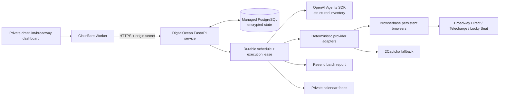

# Broadway runner

The landing page remains on Cloudflare. An authenticated API on DigitalOcean owns the schedule, preferences, browser sessions, and entry journal. OpenAI Agents SDK extracts structured lottery inventory from observed provider pages; deterministic adapters enforce authorization and execute the free-entry flow. Browserbase supplies persistent remote browser contexts, proxies, and supported CAPTCHA handling. The existing 2Captcha account is available for supported form challenges. Resend delivers a persisted report after every batch.

## Boundaries

* Your standing permission includes free entries, required lottery terms, and CAPTCHA completion. No per-show approval is invented. No purchase or claim-to-pay operation exists in the adapter interface.
* The model receives provider inventory, never account passwords or API keys. It cannot operate the browser or override eligibility. Tracing is disabled.
* The form and final submission are separate steps. Immediately before submitting, the runner checks the off switch, execution lease, availability, and a unique entry key. A saved uncertain attempt survives crashes and blocks resubmission until reconciliation.
* A CAPTCHA token is not a completed challenge. A submit click is not a confirmed entry. Status distinguishes pending verification, uncertain response, confirmed, blocked, and already recorded.
* An off toggle stops new submissions. It cannot retract an HTTP request already sent to a provider. Read-only checks can reconcile those entries.
* Scheduled slots are 09:05 and 10:05 America/New_York with a 30-minute catch-up window and one durable key per slot. A 90-second renewable execution lease prevents concurrent batches across deploys. All providers are processed serially.
* The hosted runner stays off during migration. The Codex heartbeat must be paused only after hosted access and entry verification are proven. The migration flag prevents accidentally enabling both schedulers.

## Privacy and access

The public site contains only the dashboard shell. Every private API requires a secure HttpOnly SameSite cookie, an origin check for mutations, and a Worker-to-origin secret. The database encrypts profile, keys, sessions, private screenshots, and reports with Fernet; its encryption key is a DigitalOcean runtime secret. Browserbase session recording/logging is disabled. Provider screenshots remain private. The database is a dedicated managed cluster with backups; retain the encryption key separately to make backups recoverable. No key or DOB is returned by the status endpoint.

## Deployment

Build `services/broadway/Dockerfile` as a DigitalOcean App Platform web service with one instance. Required runtime secrets: `DATABASE_URL` (PostgreSQL, TLS), `DATA_ENCRYPTION_KEY`, `ORIGIN_SECRET`, `BOOTSTRAP_TOKEN_HASH`. `PUBLIC_ORIGIN=https://dmitri.im`. Health endpoint `/healthz`. Application access logs are disabled to keep session/setup metadata out of logs.

Cloudflare secrets: `BROADWAY_ORIGIN` (the App Platform HTTPS origin) and `BROADWAY_ORIGIN_SECRET` (same as `ORIGIN_SECRET`). The existing static site allowlist includes only `broadway/`; backend code and secrets are excluded.

Create the first password through the one-time bootstrap endpoint. Connect OpenAI, Browserbase, calendar feeds, and a verified Resend sender in the private dashboard. Import the existing profile and ledger before handing over the scheduler. Telecharge Facebook authentication may require a one-time interactive login in the hosted browser, followed by persisted context reuse.

## Verification status

Local tests cover encrypted storage, exclusive leases, duplicate schedule slots, restart deduplication, response-loss uncertainty, stopping before final submit, read-only inspection, private endpoint authorization, CSRF, and secret redaction. These are infrastructure tests, not proof of live lottery acceptance.

The first standalone Chromium probe on October 28 encountered Cloudflare verification on Broadway Direct and HTTP 403 on Lucky Seat. Telecharge loaded its embedded application. Browserbase, account login persistence, exact selectors, real CAPTCHA acceptance, calendar fetch, and report delivery must be validated live before calling this unattended system complete. Lucky Seat's exact performance selector and persisted-results reconciliation are still pending that access. Current code fails closed at these unresolved steps.

## Operating costs

Target infrastructure: one 1 GB App Platform instance plus the smallest managed PostgreSQL cluster. Browserbase Developer is currently $20/month plus proxy overage. OpenAI and 2Captcha are usage-based. Verify the selected DigitalOcean cluster/instance price before provisioning. Browserbase's more capable Verified browser is a Scale-plan feature, not included in the Developer plan; successful access to these particular lottery providers must be measured rather than assumed.
